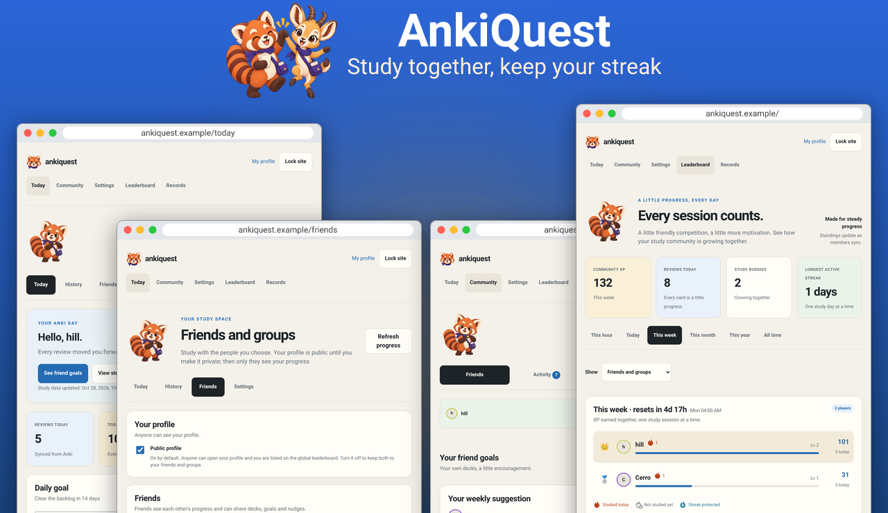

> Anki is hard, free and effective.
>
> Duolingo is easy, commercial and ineffective.
>
> If you ask a random successful language learner what software to use they'll probably suggest Anki.
>
> —lsusr, [Invisible Choices, Made by Default](https://www.lesswrong.com/s/3xKXGh9RXaYTYZYgZ/p/k6nncsXAZD3bK6fe3)

<p align="center">

</p>

<a href="https://github.com/AnkiQuest/AnkiQuest-Server/actions/workflows/ci.yml"></a>
<a href="https://github.com/AnkiQuest/AnkiQuest-Server/commits/master"></a>
<a href="https://github.com/AnkiQuest/AnkiQuest-Server/graphs/contributors"></a>
<a href="https://github.com/AnkiQuest/AnkiQuest-Server/blob/master/LICENSE"></a>

# AnkiQuest-Server

The AnkiQuest server (Rust) and its website (TypeScript), with the API examples, shared fixtures and companion art both clients use.

AnkiQuest leaves Anki's scheduling unchanged and adds streaks, friends and leaderboards to keep you studying.

AnkiQuest adds XP, streaks, daily quests, friends and leaderboards to Anki. Clients send review history without card content; sharing a conquered card label or a deck copy is an explicit choice. AnkiQuest has three repositories:

- [AnkiQuest-Server](https://github.com/AnkiQuest/AnkiQuest-Server): the server and its website.
- [AnkiQuest-Desktop](https://github.com/AnkiQuest/AnkiQuest-Desktop): the Anki desktop add-on.
- [AnkiQuest-Android](https://github.com/AnkiQuest/AnkiQuest-Android): the Android app, a fork of AnkiDroid.

## Install

To play, create an account on a server, such as [ankiquest.rationality-munich.com](https://ankiquest.rationality-munich.com), then sign in from the desktop add-on or the Android app.

To run your own server, follow the [installation guide](docs/install.md) for a local build, NixOS with HTTPS, health checks, backups and updates, and [server configuration](docs/server.md) for settings and administration. AnkiQuest does not replace AnkiWeb or an Anki sync server.

On NixOS, add the flake input and import its module:

```nix
inputs.ankiquest.url = "github:AnkiQuest/AnkiQuest-Server";
imports = [inputs.ankiquest.nixosModules.default];
```

## Development

```sh
rustup target add wasm32-unknown-unknown
npm ci
cargo fmt --all --check
cargo clippy --workspace --all-targets -- -D warnings
cargo test --workspace
npm run typecheck
npm run test:web
```

Repository tools are in `crates/xtask` (`cargo run -p ankiquest-xtask -- <command>`), including the exporters that write companion art from `static/` into an Android or Desktop checkout. See [development](docs/server.md#development).

- [Client API](docs/mobile-api.md) and recorded [API examples](docs/api/examples/). Clients copy the examples and fixtures at a pinned commit of this repository.
- `tests/fixtures/*.json`: rules both clients compute (streak verdicts, heatmap, study time, card labels, deck names, companion poses, observed study). The server and both clients test against these cases.
- The banner above shows the website. `npm run screenshots:web` renders the pages in `static/` into `docs/screenshots/web/`, answering every API call from `docs/api/examples/`. The render pins Playwright's own Chromium (from the locked `playwright` package), the fonts (Roboto, DejaVu from npm, Noto Color Emoji v2.051 checked by hash; no system fonts), the clock, locale, time zone, viewport and device scale. It runs on Linux (fontconfig); the CI `screenshots` job runs it and fails unless the committed files are byte-identical, and uploads its renders when they differ.
- `ankiquest-banner`, the banner tool every AnkiQuest repository shares ([AnkiQuest-Dev](https://github.com/AnkiQuest/AnkiQuest-Dev#readme-banner-and-social-preview)), draws `docs/graphics/banner_readme.png` and `social_preview.png` from those screenshots and the duo master; `docs/graphics/banner.toml` lists its inputs. `cargo run --release --manifest-path ../AnkiQuest-Dev/tools/banner/Cargo.toml -- --server . --record` renders the screenshots first and then draws both. The CI `banner` job fails unless the committed images have the drawn pixels.

## License

AGPL-3.0-or-later.

Anki-tan (`static/anki-tan/`) is by [Shigeyuki](https://www.patreon.com/Shigeyuki), from the [Anki-tan asset pack](https://shigeyukey.github.io/shige-addons-wiki/Anki-tan.html), licensed [CC BY-SA 4.0](https://creativecommons.org/licenses/by-sa/4.0/). Derivatives of her art are CC BY-SA 4.0 too.
