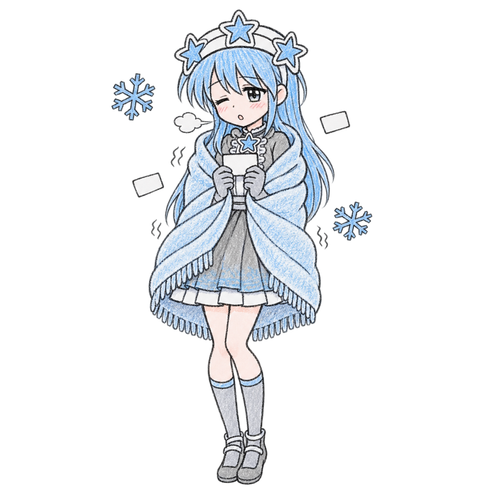
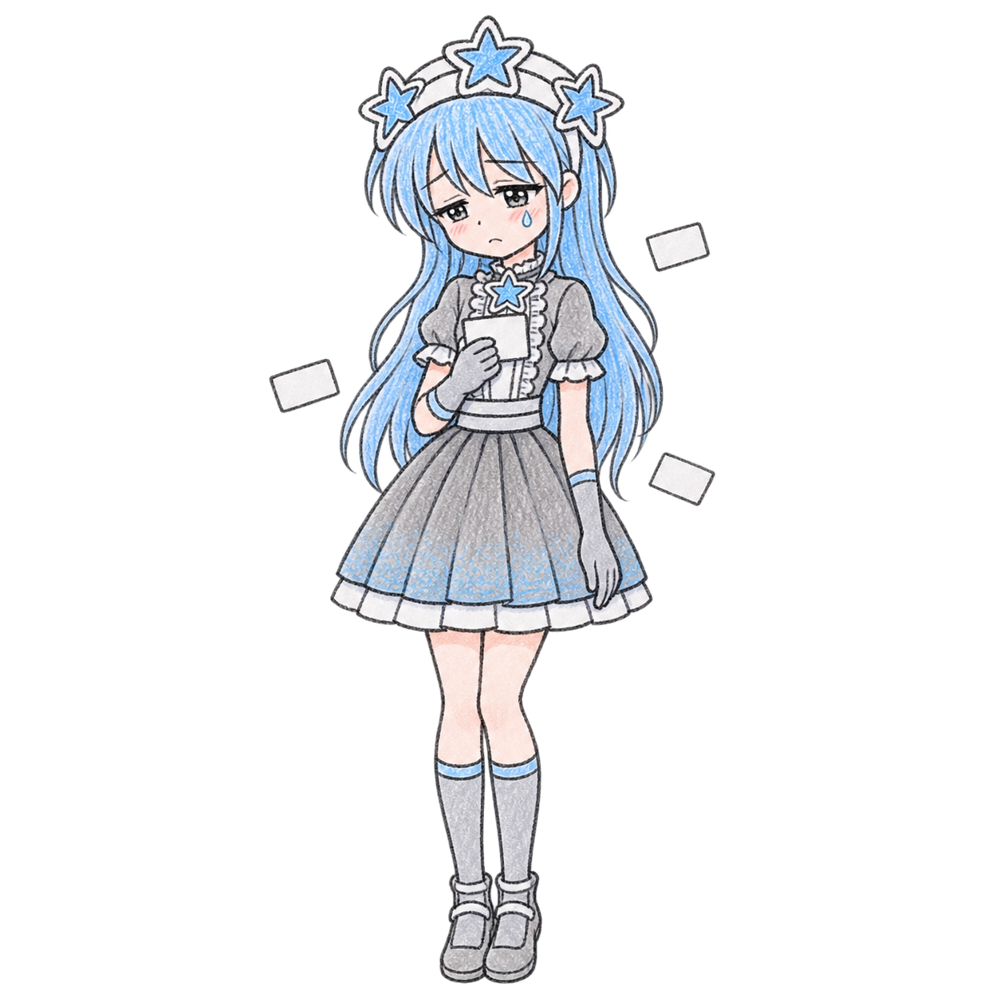

# Full-size Anki-tan additions

Part of [#88](https://github.com/AnkiQuest/AnkiQuest-Desktop/issues/88).
Adds asleep, sad and neglected masters. These supply full-size art where
the imported pack uses chibi faces. Streak is still outstanding. The
other agent owns pose selection and unlock activation.

| Original reference | Existing frozen | Asleep | Sad | Neglected |
|---|---|---|---|---|
|  |  |  |  |  |

Aldana approved these three images on 2026-11-16. Three candidates
were generated per pose using OpenAI's `image_gen` tool; its model
identifier was not exposed. Selections: asleep A, sad A, neglected C.
The approved frozen derivative and Shigeyuki's main illustration were
the reference images. [Prompts](generation.json) retain all nine variants.

Each master is 1254 x 1254 RGBA, with no text. The existing
[alpha cleanup](../alpha-cleanup/README.md) clears only pixels with
alpha 1-4. [Measurements](measurements.json) record source/output hashes,
unchanged pixels above alpha 4, and a maximum composite change of 4/255.
The selected art was inspected on white, dark and grey, including 64 px
and 128 px previews. Original art is preserved.

Anki-tan by Shigeyuki (https://www.patreon.com/Shigeyuki).
These derivatives and their exports are licensed CC BY-SA 4.0 under
[her LICENSE](../../../static/anki-tan/LICENSE).

Canonical exports use `export-addon-art` and `export-android-art` on
Linux. [Run 43789530883](https://github.com/AnkiQuest/AnkiQuest-Desktop/actions/runs/43789530883)
generated both clients' files from e8794893e539622078dbbdab4b4ffdd2a20c2e78.
All 31 existing add-on poses remained byte-identical. The three new
add-on files match the hashes in `crates/xtask/art-exports.json`.
The Android companion work is tracked in
[AnkiQuest-Android#337](https://github.com/AnkiQuest/AnkiQuest-Android/issues/337).

The Companion art exports workflow retains both clients' output, the
manifest and its diff for seven days. It never commits files; contributors
inspect the artifact and commit the selected exports before final CI.

The active masters use the fixture's pose names directly under
`static/anki-tan/`; chibi frozen uses `static/anki-tan/chibi/frozen.png`,
under the same licence. The earlier asleep, sad and neglected master names
are kept byte for byte in `static/archive/anki-tan/`. The published generated
frozen files remain in place. These canonical
asleep and sad paths are exact copies of those approved masters.

hill requested one unlit headband star for neglected, two for abandoned and
three for dead in [#88](https://github.com/AnkiQuest/AnkiQuest-Desktop/issues/88#issuecomment-6920200927).
Aldana approved the revised neglected image on 2026-11-16. Only neglected
changes here; the other two poses remain future work. The earlier neglected
master stays byte for byte in `static/archive/anki-tan/neglected-full.png`.
[The edit record](neglected-revision.json) contains the prompt, model
disclosure, hashes and cleanup measurements. The new master was inspected
at full size and 64 px on light and dark backgrounds. Canonical
[Linux run 43904416492](https://github.com/AnkiQuest/AnkiQuest-Desktop/actions/runs/43904416492)
generated its exports. The earlier desktop PNG is retained under the same
licence in `static/archive/anki-tan/addon/`.

The asleep export is now `anki_tan_asleep`. Its PNG is the byte-identical
Linux export formerly named `anki_tan_sleeping`, which is preserved under
`static/archive/anki-tan/addon/`.
It is excluded from the app package. No existing artwork was overwritten.

The inventory uses canonical paths, without an exporter-registration
fallback. Its regression still checks the same full-size poses and chibi
frozen fallback. That regression failed before the original fix in CI run
43793210490: asleep was Missing instead of Present (48 xtask tests passed,
one failed). Missing master files still do not count.
