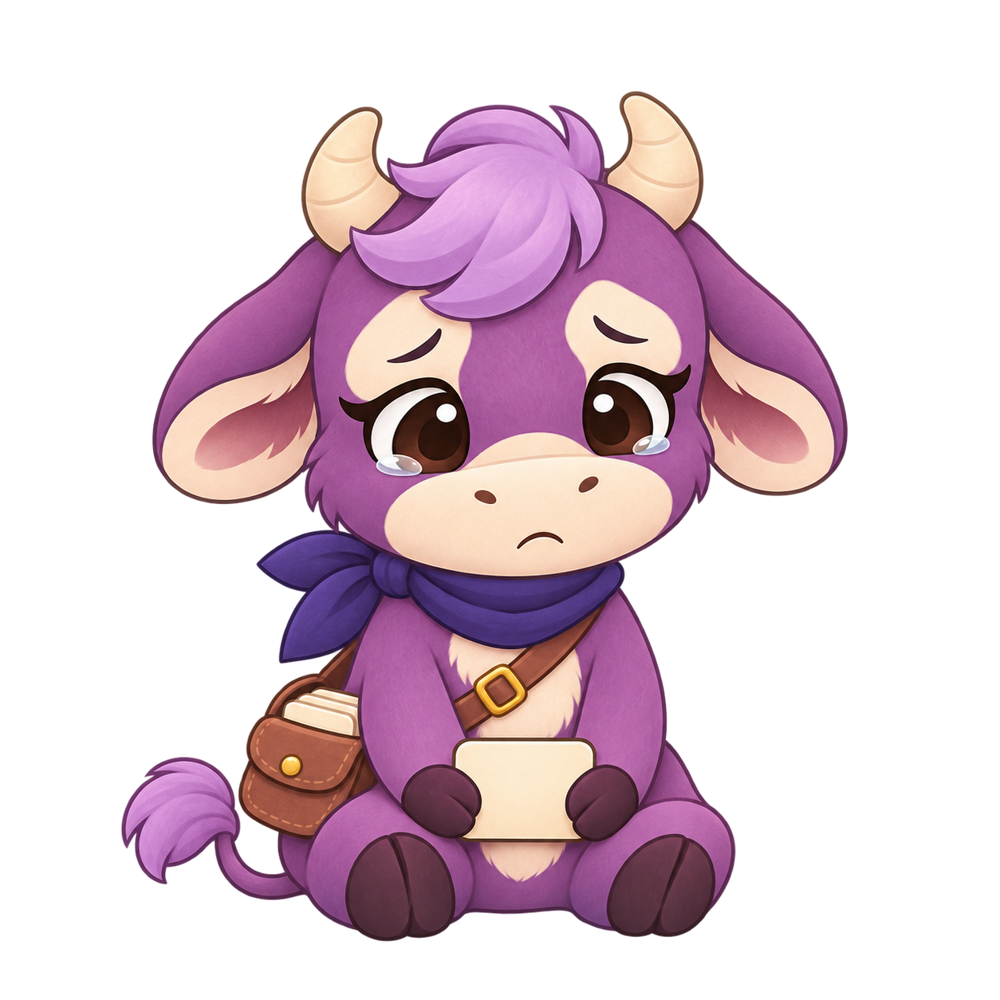

# Bluma core poses

Art for [#321](https://github.com/AnkiQuest/AnkiQuest-Desktop/issues/321),
part of [#88](https://github.com/AnkiQuest/AnkiQuest-Desktop/issues/88).
[hill approved all eight images](https://github.com/AnkiQuest/AnkiQuest-Desktop/pull/322#pullrequestreview-5919330018). This supplies assets;
the other contributor owns pose selection and unlock activation.

| Aki reference | Ankilope reference | Bluma face | Bluma happy |
|---|---|---|---|
|  |  |  |  |

| Asleep | Streak | Sad |
|---|---|---|
|  |  |  |

| Hopeful | Frozen | Neglected |
|---|---|---|
|  |  |  |

OpenAI `image_gen` generated three candidates per pose on 2026-11-16;
its model identifier was not exposed. [Generation records](generation.json)
retain all 24 prompts. Happy C established the cow's identity; the other
poses used that image as their reference. Selections: face C, asleep A,
happy C, streak B, sad C, hopeful B, frozen B and neglected B. Happy B
had an extra limb; hopeful A had a broad glow. The selected set preserves
the same face, scarf, satchel, markings and proportions.

Each master is 1254 x 1254 RGBA, with no text. The existing
[alpha cleanup](../alpha-cleanup/README.md) clears only alpha 1-4.
[Measurements](measurements.json) record source/output hashes, unchanged
pixels above alpha 4 and a maximum composite change of 4/255. Inspected
each pose on white, dark and grey, at native size and 64/128 px. Original
artwork is preserved; these masters and exports use new `bluma_*` names.

[Reusable prompts](prompts.md) supply a style prompt and one prompt per
core pose for the custom-companion template. Active masters now use the
fixture names in `static/cow/`, matching the companion id. Happy and
asleep export as `bluma_happy` and `bluma_asleep`. Earlier `static/bluma/`
masters and the `celebrate`/`sleeping` exports remain byte-identical in
`static/cow/archive/`, outside the app package, as old art. The canonical
paths contain exact copies of the same generated art, without processing.

The existing Rust exporters produced canonical 256 px add-on PNGs and
1024 px Android WebPs on Linux in
[run 43793906258](https://github.com/AnkiQuest/AnkiQuest-Desktop/actions/runs/43793906258),
source `d7b7b96e7c7a50ddb7559f898ef2b16932f63367`. All 34 existing add-on
images remained byte-identical. [Export hashes](exports.json) record the
eight new PNGs and WebPs; the PNG hashes also match the art manifest.
That provenance record retains the original filenames. The two renamed
PNG exports have the same bytes and hashes; final CI regenerates and
checks them against the canonical master paths.
Android parity is tracked in
[#340](https://github.com/AnkiQuest/AnkiQuest-Android/issues/340).
