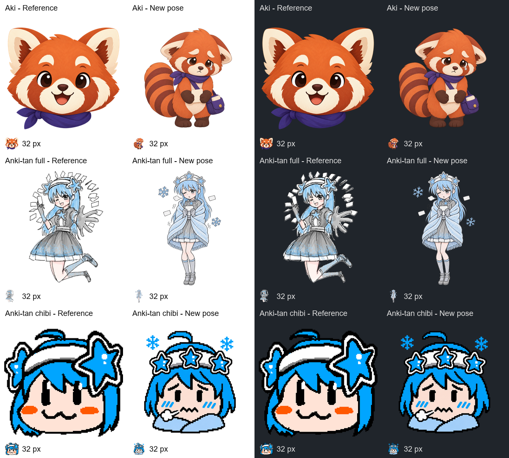

# Core pose additions

Part of [#88](https://github.com/AnkiQuest/AnkiQuest-Desktop/issues/88). This batch adds
Aki's sad, hopeful, frozen and neglected poses, plus Anki-tan's full and chibi frozen poses. Pose selection belongs
to the companion implementation; this change only supplies art and exports.

The images were generated with OpenAI's built-in image generation tool
(`image_gen`). The tool did not expose its model identifier; no model name is
asserted. Three candidates were generated for each pose. The selected candidates
are Aki sad B, hopeful B, frozen A and neglected B, plus Anki-tan full C and chibi C. [Exact prompts](generation.json)
include all 18 candidates. [Reusable prompts](prompts.md) split style from pose.

The references are the existing Aki masters and Shigeyuki's Anki-tan asset pack
from [#274](https://github.com/AnkiQuest/AnkiQuest-Desktop/pull/274), commit
`cd46210748d5dd7daaaf0823804e3019c1df4425`. The full pose keeps her hand-drawn
linework; the chibi keeps the emoji pack's stepped outlines and flat colours.
Both show three headband stars. Aki keeps the orange/cream palette and indigo
scarf and satchel. The owner has final approval of their appearance.

Anki-tan by Shigeyuki (https://www.patreon.com/Shigeyuki). Both new Anki-tan poses,
their exports and her portions of this comparison are derivatives licensed
[CC BY-SA 4.0](https://creativecommons.org/licenses/by-sa/4.0/), under
[her LICENSE](../../../static/anki-tan/LICENSE). Her original files are unchanged.

All masters are 1254 x 1254 RGBA PNGs without text. The established
[alpha cleanup](../alpha-cleanup/README.md) removes pixels with alpha 1-4, plus
isolated 8-connected components whose maximum alpha is 16 or less. It does not
erode or redraw contours. [Measurements](measurements.json) record hashes, pixel
counts and bounds. The resulting poses were inspected on white and dark at
large size and 32 px.

Exports use the existing Rust tools: 1024 px WebP for Android and 256 px indexed
PNG for desktop. Export Android art into an empty staging directory, then copy
only the six new files; export desktop without `--replace`. Existing art stays
untouched. Android parity is supplied in a linked companion-art PR.

[Desktop and Android export comparison](exports-review.png) checks the generated
PNG/WebP at the same visible size on white and dark backgrounds. Android parity:
[issue #293](https://github.com/AnkiQuest/AnkiQuest-Android/issues/293).

[Aki’s completed core additions beside the existing references](aki-core-review.png)
show both light and dark backgrounds. [Their desktop and Android exports](aki-core-exports.png)
were also compared at the same visible size.

This PR depends on the reference pack in #274. The icon exports in #277 are
compatible and keep their own source names. The add-on settings credit from
#287 is included with this first shipment of Anki-tan art, as the owner requested.
